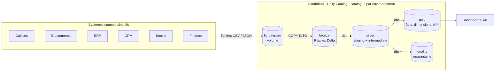
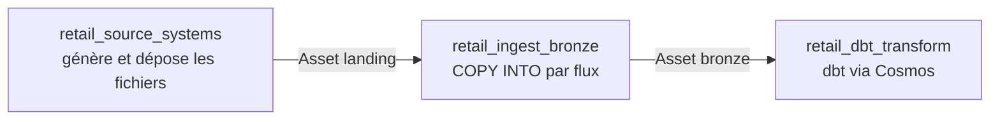

# 1. Vue d'ensemble

## 1.1 Le contexte métier

**Stride Sports** est une enseigne fictive d'articles de sport :

- **12 magasins** dans 5 pays : France (6, dont le flagship Paris La Défense et Toulouse qui ouvre pendant la
  période), Espagne (2), Italie (1), Royaume-Uni (2), Suisse (1). Trois devises : EUR, GBP, CHF.
- **un site e-commerce** qui livre en Europe (FR, ES, IT, BE, GB, CH), avec livraison à domicile, en point
  relais ou en **click & collect** dans un magasin.
- **7 sports** et leurs marques maison : running (Runova), vélo (Pedalix), randonnée (Summitra), natation
  (Aquaflow), football (Goalix), fitness (Fitora), ski (Skivo). Environ 280 produits, avec une **saisonnalité**
  (le ski se vend l'hiver, la natation l'été, le fitness en janvier).

Les questions auxquelles la plateforme répond :

| Utilisateur | Question | Modèle gold |
|---|---|---|
| Directeur de magasin | chiffre d'affaires, panier moyen, marge, ruptures de stock par jour | `mart_store_daily_kpis` |
| Équipe e-commerce | volumes, annulations, délais d'expédition et de livraison, retours | `mart_web_fulfilment`, `fct_web_returns` |
| Contrôle de gestion | ventes et marges en EUR, tous canaux, avec le coût du produit à la date de vente | `fct_sales_lines`, `dim_product` |
| Data science | historique des ventes et des stocks pour la prévision de la demande | `fct_sales_lines`, `fct_inventory_daily` |
| DPO (RGPD) | aucune donnée personnelle conservée après une demande d'effacement | `int_customers_current`, macro de purge |

## 1.2 L'architecture



Orchestration (Airflow 3, sur Astro) : trois DAGs chaînés par des **Assets**.



## 1.3 Les briques et leur rôle

| Brique | Rôle | Où |
|---|---|---|
| Générateur Python | joue le rôle des systèmes sources : produit chaque jour les fichiers de 9 flux, avec des défauts réalistes | `include/retail_generator/` |
| Volume Unity Catalog | zone d'atterrissage des fichiers (équivalent d'un bucket S3 gouverné) | `<catalogue>.landing.raw` |
| `COPY INTO` | chargement idempotent des fichiers en tables Delta bronze | `include/ingestion/bronze.py` |
| dbt (`dbt-databricks`) | toute la transformation : silver, gold, quality, tests, documentation | `dags/dbt/retail/` |
| SQL warehouse Databricks | le compute qui exécute le SQL de dbt et les `COPY INTO` | Databricks Free Edition |
| Airflow 3 + Cosmos | orchestration ; Cosmos transforme chaque modèle dbt en tâche Airflow | `dags/` |
| Astronomer | héberge Airflow : en local (`astro dev`) et dans le cloud (Deployments uat, prod) | `Dockerfile`, Astro |
| GitHub Actions | tests à chaque pull request, déploiement automatique par branche | `.github/workflows/ci-cd.yml` |

## 1.4 Les choix techniques, et pourquoi

| Choix | Pourquoi | Alternative écartée |
|---|---|---|
| **Générateur déterministe** (même jour = mêmes fichiers) | une relance ou un backfill est idempotent ; un incident se reproduit à l'identique | données aléatoires : impossible de rejouer un jour |
| **Bronze en texte** (CSV chargés en `string`) | le chargement ne casse jamais sur un type inattendu ; le typage se fait dans dbt, testé | inférence de types au chargement : fragile |
| **`COPY INTO`** plutôt qu'Auto Loader | SQL simple, idempotent, utilisable depuis Airflow avec un SQL warehouse | Auto Loader : demande un job ou un pipeline Lakeflow |
| **`PATTERN` par jours livrés** | évite de relister et de relire des centaines de fichiers (voir 04, « petits fichiers ») | charger le dossier entier : ne terminait jamais |
| **dbt pour toute la transformation** | SQL versionné, testé, documenté, lignage ; Databricks ne sert que de compute et de stockage | notebooks : peu testables, peu relus |
| **Staging en vues, marts en tables** | les vues ne coûtent rien à construire ; les tables gold sont lues souvent | tout en tables : coût de stockage et de build inutile |
| **`fct_sales_lines` incrémental `merge`** sur l'heure d'ingestion | capte les fichiers et événements en retard sans tout recalculer | filtre sur la date métier : rate les données en retard |
| **SCD2 reconstruit depuis les extraits** | l'historique reste complet même si on charge 3 mois d'un coup | snapshot dbt seul : ne voit que l'état au moment où il tourne |
| **Quarantaine** plutôt que suppression silencieuse | le métier voit et corrige les données fausses | filtrer sans trace : on perd du chiffre d'affaires sans le savoir |
| **Cosmos** plutôt qu'un `dbt build` dans une seule tâche | un modèle = une tâche : on voit et on relance précisément ce qui a échoué | BashOperator unique : tout ou rien |
| **Assets** plutôt qu'un horaire fixe par DAG | l'ingestion démarre quand les fichiers sont là, dbt quand le bronze est à jour | horaires décalés : course entre DAGs |
| **Un catalogue par environnement** | isolation simple des données et des droits dans Unity Catalog | préfixes de schémas : droits difficiles à séparer |

## 1.5 Les chiffres (historique initial du 1er juillet au 17 octobre 2026)

| Mesure | Valeur |
|---|---|
| Fichiers déposés | ~2 100 (19 par jour en moyenne) |
| Lignes bronze | ~900 000 (POS 261 000, commandes web 273 000, stocks 331 000…) |
| Lignes de vente en gold | ~396 000 (260 000 magasin, 136 000 web) |
| Chiffre d'affaires | ~23 M€ |
| Doublons retirés | ~3 800 lignes de caisse |
| Lignes en quarantaine | ~1 500 (produit inconnu, quantité nulle, prix négatif) |
| Versions de produits (SCD2) | 663 pour 283 produits |
| Clients anonymisés (RGPD) | 140 |
| `dbt build` complet | ~80 s en local, 3 à 4 min via Cosmos (une tâche par modèle) |

## 1.6 Arborescence

```
retail-lakehouse/
├── .github/workflows/ci-cd.yml      CI/CD : tests, déploiement uat et prod
├── Dockerfile                       image Astro Runtime + virtualenv dbt
├── requirements.txt                 Cosmos, provider Databricks, SDK
├── .env.example                     variables locales (copier en .env)
├── dags/
│   ├── retail_source_systems.py     DAG 1 : sources -> landing
│   ├── retail_ingest_bronze.py      DAG 2 : landing -> bronze
│   ├── retail_dbt_transform.py      DAG 3 : bronze -> silver / gold (Cosmos)
│   └── dbt/retail/                  projet dbt
├── include/
│   ├── retail_generator/            générateur des systèmes sources
│   └── ingestion/                   COPY INTO bronze
├── scripts/sync_airflow_connection.py
├── tests/                           générateur + intégrité des DAGs
└── docs/                            cette documentation
```
