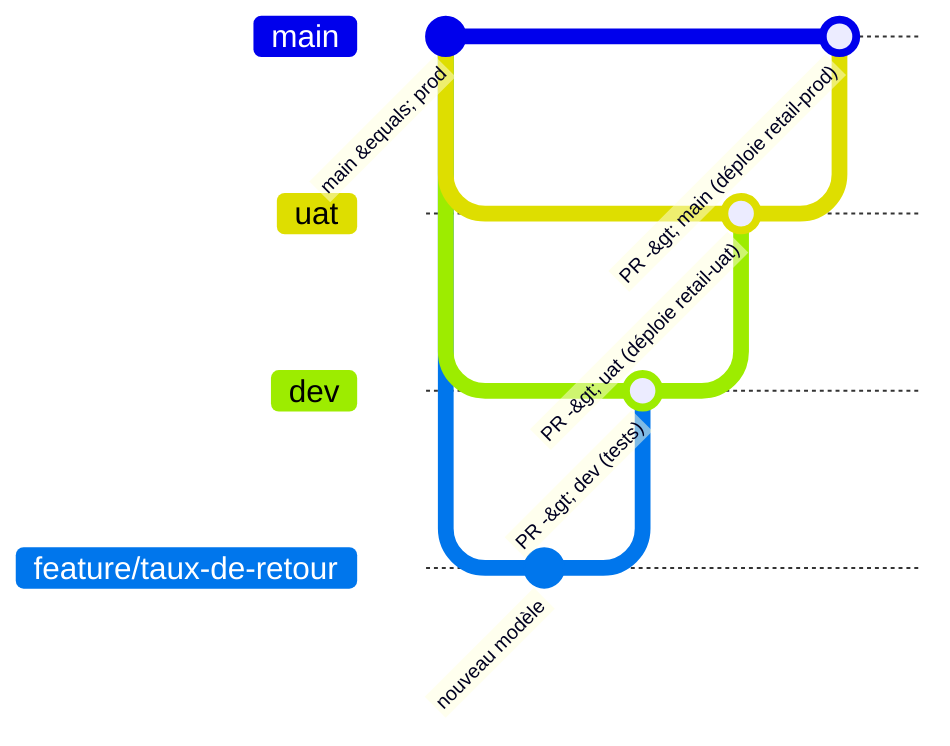

# 2. Les environnements : dev, uat, prod

## 2.1 Vue d'ensemble

| | **dev** | **uat** | **prod** |
|---|---|---|---|
| Rôle | développer, tester ses changements | validation par le métier, répétition de la mise en prod | la vraie production |
| Airflow | **local** : `astro dev start` (Docker) | Astro cloud, Deployment `retail-uat` | Astro cloud, Deployment `retail-prod` |
| Catalogue Databricks | `retail_dev` (ou `retail`, bac à sable) | `retail_uat` | `retail_prod` |
| Target dbt | `local` ou `dev` | `uat` | `prod` |
| Données | à la demande (déclenchement manuel) | un nouveau jour chaque nuit à 1 h | un nouveau jour chaque nuit à 1 h |
| Branche Git | `dev` (et branches de fonctionnalité) | `uat` | `main` |
| Déploiement | aucun : le code local est monté dans les conteneurs | automatique au push sur `uat` | automatique au push sur `main` |
| Mise en veille | — | mode développement (hibernation possible) | toujours actif |

> **Pourquoi dev est en local ?** L'essai gratuit d'Astro limite à **2 Deployments**. C'est aussi un schéma
> très courant en entreprise : chaque développeur a son Airflow local (Astro CLI), et seuls les environnements
> partagés (recette, production) sont hébergés.

## 2.2 Isolation dans Databricks

Un seul workspace Databricks (Free Edition), mais **un catalogue Unity Catalog par environnement** :

```
retail_dev    retail_uat    retail_prod        (+ retail : bac à sable local)
 ├── landing        (volume raw : les fichiers)
 ├── bronze         (tables brutes)
 ├── silver         (staging + intermediate)
 ├── gold           (faits, dimensions, KPI)
 ├── quality        (quarantaine)
 └── snapshots      (snapshot dbt)
```

- Le catalogue est créé par la tâche `create_catalog_objects` du DAG d'ingestion
  (`CREATE CATALOG IF NOT EXISTS`), à partir de la variable `DATABRICKS_CATALOG`.
- dbt écrit dans le catalogue de la target (`catalog` du profil = `DATABRICKS_CATALOG`).
- La macro `generate_schema_name` nomme les schémas d'après la couche (`silver`, `gold`…) pour `dev`, `uat` et
  `prod`. Pour la target `local`, elle les préfixe (`local_silver`, `local_gold`…) : un développeur ne peut pas
  écraser un environnement partagé.

**En entreprise**, on irait plus loin : un workspace ou au moins un **principal de service** par
environnement, avec des droits Unity Catalog distincts (le compte de prod est le seul à écrire dans
`retail_prod`). La Free Edition n'a qu'un utilisateur et un token : c'est une simplification assumée.

## 2.3 Configuration de chaque Deployment Astro

| Variable | uat | prod | Secret ? | Rôle |
|---|---|---|---|---|
| `DATABRICKS_HOST` | host du workspace | idem | non | adresse Databricks |
| `DATABRICKS_HTTP_PATH` | `/sql/1.0/warehouses/…` | idem | non | SQL warehouse utilisé |
| `DATABRICKS_TOKEN` | token | token | **oui** | authentification (SDK, dbt) |
| `AIRFLOW_CONN_DATABRICKS_DEFAULT` | JSON de connexion | idem | **oui** | connexion Airflow utilisée par `DatabricksSqlOperator` |
| `DATABRICKS_CATALOG` | `retail_uat` | `retail_prod` | non | isole l'environnement |
| `DBT_TARGET` | `uat` | `prod` | non | target dbt utilisée par Cosmos |
| `RETAIL_EPOCH` | `2026-07-01` | `2026-07-01` | non | début de l'historique simulé |
| `RETAIL_SOURCES_SCHEDULE` | `0 1 * * *` | `0 1 * * *` | non | planning du DAG des sources (`none` = manuel) |

Paramètres des Deployments : AWS `us-east-1`, Astro Runtime `3.3-9` (Airflow 3.3.2), CeleryExecutor, scheduler
`small`, uat en *development mode* (hibernation), prod sans.

**Les secrets ne sont jamais écrits dans le code ni dans le dépôt.** Ils ont été chargés depuis `.env` vers
Astro en tant que variables *secret* (masquées dans l'interface et la CLI). Pour les changer :

```bash
astro deployment variable update -d <deployment-id> DATABRICKS_TOKEN=<nouveau> --secret
```

## 2.4 Le cycle de vie du code



1. **Développer** sur une branche `feature/…` en local : `astro dev start` + target `local`.
2. **Pull request vers `dev`** : la CI lance les tests (générateur, `dbt parse`, intégrité des DAGs).
3. **Pull request `dev` → `uat`** : au merge, la CI déploie sur `retail-uat`. Le métier valide sur les données
   de recette.
4. **Pull request `uat` → `main`** : au merge, la CI déploie sur `retail-prod`.

Le **même code** traverse les trois environnements. Seule la configuration change (variables du Deployment) :
c'est le principe « build once, configure per environment ».

## 2.5 La CI/CD (GitHub Actions)

Fichier : `.github/workflows/ci-cd.yml`.

| Job | Quand | Ce qu'il fait |
|---|---|---|
| `generator-and-dbt` | toujours | tests pytest du générateur, `dbt deps` + `dbt parse` (aucun warehouse nécessaire) |
| `dag-integrity` | toujours | installe la CLI Astro, lance `astro dev pytest tests/dags` dans l'image Astro Runtime |
| `deploy` | push sur `uat` ou `main`, si les deux jobs précédents sont verts | `astro deploy <ASTRO_DEPLOYMENT_ID> --force` : construit l'image, la pousse, met à jour DAGs et dbt |

Côté GitHub, deux **environnements** :

| Environnement GitHub | Variable `ASTRO_DEPLOYMENT_ID` | Secret `ASTRO_API_TOKEN` | Branche autorisée |
|---|---|---|---|
| `uat` | id de `retail-uat` | token **de Deployment** `github-actions` de `retail-uat` (rôle `DEPLOYMENT_ADMIN`, 90 jours) | `uat` uniquement |
| `prod` | id de `retail-prod` | token de Deployment `github-actions` de `retail-prod` | `main` uniquement |

> **Pourquoi un token par Deployment ?** Moindre privilège : le token de uat ne peut pas déployer en prod. C'est
> aussi une contrainte de l'essai Astro, qui n'autorise que des tokens de workspace de rôle *Owner* (trop larges).

> **Limite du forfait GitHub gratuit :** pas de « required reviewers » sur un dépôt privé, donc pas
> d'approbation manuelle avant la prod. En entreprise, on l'activerait sur l'environnement `prod`, avec une
> protection de branche sur `main` (pull request obligatoire, CI verte, relecture).

**Les tokens Astro expirent après 90 jours.** Pour les renouveler :

```bash
astro deployment token create --deployment-id <id-retail-prod> --name github-actions \
  --role DEPLOYMENT_ADMIN --expiration 90 --clean-output \
  | gh secret set ASTRO_API_TOKEN --env prod -R LAGRAINIA/retail-lakehouse
```

## 2.6 Démarrer l'environnement dev (local)

```bash
cd ~/Projects/retail-lakehouse
cp .env.example .env              # remplir DATABRICKS_HOST / HTTP_PATH / TOKEN
python scripts/sync_airflow_connection.py
# dans .env : DATABRICKS_CATALOG=retail_dev et DBT_TARGET=dev pour reproduire un vrai environnement,
#             ou garder retail + local comme bac à sable
astro dev start                   # Airflow sur http://localhost:8080 (ou l'URL affichée)
```

Puis dans Airflow : DAG `retail_source_systems` → *Trigger* avec `start_date` et `end_date` pour charger
l'historique. Ingestion et dbt suivent automatiquement.

## 2.7 Premier chargement d'un environnement cloud

Le DAG des sources tourne chaque nuit, mais **l'historique** (depuis `RETAIL_EPOCH`) se charge une fois, à la
main : dans l'interface Airflow du Deployment, *Trigger* `retail_source_systems` avec
`start_date = 2026-07-01` et `end_date = <hier>`. Compter 5 à 10 minutes pour le dépôt des fichiers, quelques
minutes pour le bronze, 4 minutes pour dbt.
