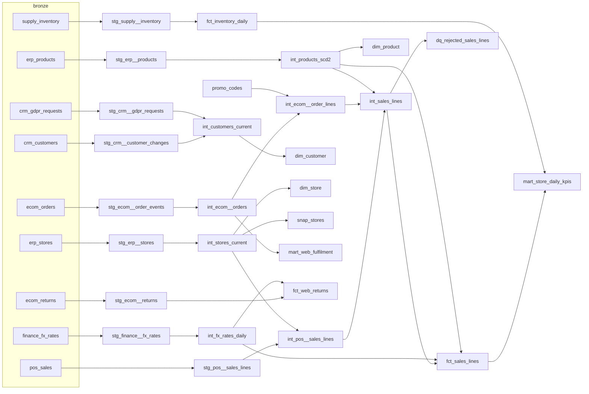

# 5. Le projet dbt

Emplacement : `dags/dbt/retail/` (convention Astro + Cosmos : le projet est livré avec les DAGs).
Adaptateur : `dbt-databricks 1.12.7` (dbt-core 1.12). Databricks sert de **compute** (SQL warehouse) et de
**stockage** (tables Delta dans Unity Catalog) ; toute la logique est dans dbt.

## 5.1 Organisation

```
dags/dbt/retail/
├── dbt_project.yml          matérialisations et schémas par couche
├── profiles.yml             targets local / dev / uat / prod (variables d'environnement)
├── packages.yml             dbt_utils
├── macros/
│   ├── generate_schema_name.sql     nommage des schémas par environnement
│   ├── column_or_null.sql           dérive de schéma
│   └── purge_erased_customers.sql   RGPD : purge du bronze
├── models/
│   ├── staging/        9 modèles stg_*   (silver, vues)
│   ├── intermediate/   8 modèles int_*   (silver, vues)
│   └── marts/          9 modèles + quality/dq_rejected_sales_lines (gold, tables)
├── snapshots/snap_stores.yml
├── seeds/promo_codes.csv
└── tests/              4 tests singuliers
```

| Couche | Schéma | Matérialisation | Règle |
|---|---|---|---|
| staging | `silver` | vue | une source = un modèle ; renommer, typer, dédoublonner, réparer. Pas de jointure métier |
| intermediate | `silver` | vue | logique métier réutilisable : jointures, historisation, unification |
| marts | `gold` | table (incrémental pour les gros faits) | ce que lisent la BI et la data science |
| quality | `quality` | table | quarantaine des lignes rejetées |
| snapshots | `snapshots` | snapshot | historique capturé par dbt |

Nommage : `stg_<système>__<objet>`, `int_<objet>`, `fct_` (faits), `dim_` (dimensions), `mart_` (agrégats).

## 5.2 Lignage



Le lignage complet et interactif : `dbt docs generate && dbt docs serve` (et Unity Catalog, onglet *Lineage*).

## 5.3 Staging (silver)

| Modèle | Grain | Ce qu'il fait |
|---|---|---|
| `stg_pos__sales_lines` | ligne de ticket (`sale_line_id = transaction_id-line_number`) | `try_cast` de toutes les colonnes ; **répare** `store_id` vide depuis le nom du fichier (`is_store_id_repaired`) ; lit `loyalty_points` seulement s'il existe (`column_or_null`) ; extrait `business_date` du nom de fichier ; **dédoublonne** par `(transaction_id, line_number)` en préférant le fichier original au `_resend`/`_dup` |
| `stg_ecom__order_events` | événement de commande | type les horodatages ; aplatit `shipping` ; `status_rank` (ordre des statuts) ; `landing_date` (nom du fichier) et `is_late_event` ; dédoublonne `(order_id, order_status, updated_at)` |
| `stg_ecom__returns` | retour | typage, dédoublonnage sur `return_id` |
| `stg_erp__products` | produit × jour d'extrait | **tous** les extraits (pas seulement le dernier) : base du SCD2 ; `extract_date` depuis le nom du fichier |
| `stg_erp__stores` | magasin × jour d'extrait | idem |
| `stg_crm__customer_changes` | version de client | typage ; une ligne par `(customer_id, updated_at)` |
| `stg_crm__gdpr_requests` | demande | typage |
| `stg_supply__inventory` | magasin × produit × jour | typage ; garde la dernière ingestion |
| `stg_finance__fx_rates` | jour × devise | **dépivote** la structure `rates` avec `stack()` |

Exemple, le dédoublonnage :

```sql
qualify row_number() over (
    partition by transaction_id, line_number
    order by is_from_resent_file, _ingested_at, _source_file     -- l'original avant le renvoi
) = 1
```

## 5.4 Intermediate (silver)

### `int_fx_rates_daily`
**Grain :** jour calendaire × devise. Les taux ne sont publiés que les jours ouvrés : un calendrier
(`sequence()` + `explode`) est croisé avec les devises, et `last_value(rate, true)` reporte le dernier taux connu
(`is_carried_forward = true`). L'EUR est ajouté avec un taux de 1.

### `int_products_scd2`
**Grain :** version de produit (`product_version_key`). À partir de tous les extraits quotidiens, une version
commence à chaque changement d'un attribut suivi (nom, catégorie, prix, statut), détecté avec `lag()`. `valid_from`
= date de l'extrait du changement, `valid_to` = début de la version suivante (NULL pour la version courante),
`is_current`.

> **Pourquoi ne pas utiliser un snapshot dbt ?** Un snapshot ne voit que l'état au moment où il tourne. Si l'on
> charge trois mois d'extraits d'un coup (premier chargement, backfill), il ne capture que le dernier état.
> Reconstruire depuis les extraits garde **tout** l'historique, quel que soit le rythme des runs. Le snapshot
> `snap_stores` est là pour comparer.

### `int_customers_current`
**Grain :** client. Dernière version (par `updated_at`) du flux CRM. Pour un client avec une demande
d'effacement : `is_erased = true`, et **tous les attributs personnels sont mis à NULL** (nom, email, ville, code
postal, année de naissance, consentement marketing). Le client reste présent, car des ventes y font référence.

### `int_pos__sales_lines`
Ajoute `sold_at_utc`. Deux formats coexistent : v1 en heure locale sans fuseau (`to_utc_timestamp(ts,
timezone du magasin)`), v2 en ISO 8601 avec décalage (instant absolu). Le fuseau vient de `int_stores_current`.
Couvert par un **test unitaire**.

### `int_ecom__orders`
**Grain :** commande. Statut courant = dernier événement **par heure d'événement** (`updated_at`), pas par heure
d'arrivée : un `SHIPPED` arrivé en retard après le `DELIVERED` ne fait pas reculer la commande. Jalons :
`paid_at`, `shipped_at`, `delivered_at`, `cancelled_at`. Compteurs `event_count` et `late_event_count`.

### `int_ecom__order_lines`
**Grain :** ligne de commande web. `lateral view explode(lines)`, puis remise du code promo depuis le **seed**
`promo_codes` (avec dates de validité).

### `int_sales_lines`
**Grain :** ligne de vente, tous canaux. Union des lignes magasin et des lignes web **payées** (une vente web est
reconnue au paiement). Colonnes communes, `net_amount_local`, et **drapeaux qualité** :

| Drapeau | Règle |
|---|---|
| `is_unknown_product` | le SKU n'existe dans aucune version produit |
| `is_zero_quantity` | quantité 0 ou NULL |
| `is_negative_price` | prix unitaire < 0 |
| `is_missing_store` | ligne magasin sans magasin (après réparation) |
| `is_missing_timestamp` | horodatage illisible |
| `has_quality_issue` | au moins un des drapeaux |

### `int_stores_current`
**Grain :** magasin. Dernier extrait où il apparaît.

## 5.5 Marts (gold)

### `fct_sales_lines` — le fait principal
| | |
|---|---|
| Grain | une ligne de vente (magasin ou web) |
| Clé | `sale_line_id` |
| Matérialisation | **incrémental**, stratégie `merge` sur `sale_line_id`, `on_schema_change = append_new_columns` |
| Organisation | `liquid_clustered_by = ['sale_date', 'store_id']` |
| Contrat | **appliqué** (`contract: enforced`) : noms et types de colonnes garantis, `NOT NULL` vérifiés par Delta |
| Filtre incrémental | `_ingested_at > max(_ingested_at) - 1 heure` (variable `incremental_lookback_hours`) |
| Montants | devise locale + EUR (`int_fx_rates_daily` du jour de vente) ; marge brute EUR avec le **coût de la version produit valide à la date de vente** |
| Exclut | les lignes `has_quality_issue` (elles vont en quarantaine) |

> **Pourquoi filtrer sur `_ingested_at` et pas sur `sale_date` ?** Un fichier de caisse en retard ou un
> événement web tardif a une date métier **ancienne** mais une ingestion **récente**. Un filtre sur la date
> métier le raterait définitivement. Le test `assert_fct_sales_reconciles_with_silver` détecte ce genre de trou.

### Les autres modèles gold
| Modèle | Grain | Contenu |
|---|---|---|
| `fct_inventory_daily` | jour × magasin × produit | incrémental `merge` ; disponible, `is_stockout`, `is_negative_stock` |
| `fct_web_returns` | retour | montant remboursé en devise locale et EUR |
| `dim_product` | **version** de produit | SCD2 : `valid_from`, `valid_to`, `is_current` |
| `dim_store` | magasin | état courant |
| `dim_customer` | client | **sans PII** : pays, ville (NULL si effacé), tranche d'âge, fidélité, consentement |
| `dim_date` | jour (2026-2027) | `dbt_utils.date_spine` : année, trimestre, mois, semaine ISO, week-end |
| `mart_store_daily_kpis` | jour × magasin | tickets, unités vendues et retournées, CA, marge, panier moyen, taux de marge, clients identifiés, taux de rupture |
| `mart_web_fulfilment` | jour de commande | commandes, annulations, invités, heures moyennes jusqu'à l'expédition et en transit, livré en 4 jours, événements en retard |
| `quality.dq_rejected_sales_lines` | ligne rejetée | la ligne et `rejection_reasons` (liste des motifs) |

## 5.6 Snapshot et seed

- **`snap_stores`** (YAML, stratégie `check` sur `store_name`, `store_status`, `surface_m2`) : historique des
  magasins capturé par dbt. Exercice : comparer avec ce qu'aurait donné un run quotidien (ST012 `planned` → `open`).
- **`promo_codes`** : données de référence gérées dans le dépôt (code, remise, validité). Un changement de
  remise passe par une pull request, relue et testée.

## 5.7 Les macros

| Macro | Rôle |
|---|---|
| `generate_schema_name` | `silver`/`gold`… pour `dev`, `uat`, `prod` (un catalogue par environnement) ; `local_silver`… pour la target `local` |
| `column_or_null(relation, colonne, type)` | renvoie `try_cast(colonne)` si la colonne existe dans la table, sinon `cast(null as type)`. Le modèle compile **avant et après** une dérive de schéma |
| `purge_erased_customers` | `UPDATE` du bronze `crm_customers` : met à NULL les données personnelles de tout client ayant une demande d'effacement. Lancée par Airflow après chaque build (`dbt run-operation purge_erased_customers`) |

> RGPD et Delta : après l'`UPDATE`, les anciennes valeurs restent dans les **versions précédentes** de la table
> (Time Travel) jusqu'à un `VACUUM` (7 jours par défaut). Une purge complète demande donc aussi un `VACUUM`.

## 5.8 Les tests

**Génériques** (dans les `.yml`) : `unique`, `not_null`, `accepted_values`, `relationships`, et `dbt_utils` :
`unique_combination_of_columns`, `accepted_range`.

Ceux qui comptent le plus :

| Test | Sur | Sévérité | Ce qu'il attrape |
|---|---|---|---|
| `accepted_range` 0,5 – 5 000 | `stg_erp__products.unit_price_eur` | **error** | prix aberrants (incident `price_x100`) |
| `not_null` | `stg_pos__sales_lines.quantity` | **error** | colonne renommée (incident `schema_break`) |
| `accepted_range` ≥ 0 | `stg_supply__inventory.quantity_on_hand` | warn | stocks négatifs : alerte sans bloquer |
| `relationships` | `fct_sales_lines.customer_id` → `dim_customer` | warn | client absent du CRM |
| `relationships` | `fct_sales_lines.store_id` → `dim_store` | error | magasin inconnu |
| `unique` | toutes les clés | error | doublons |

**Singuliers** (`tests/`) :

| Test | Vérifie |
|---|---|
| `assert_no_pii_for_erased_customers` | aucun client effacé n'a encore de nom, d'email ou de code postal en silver |
| `assert_one_current_version_per_product` | exactement une version courante par produit (intégrité SCD2) |
| `assert_fct_sales_reconciles_with_silver` | le fait contient exactement les lignes valides de silver (dérive de l'incrémental) |
| `assert_every_open_store_reported` (warn) | chaque magasin ouvert a des ventes chaque jour jusqu'à la veille du dernier jour (incident `pos_outage`) |

**Unitaires** (`unit_tests` dans `_intermediate.yml`) : sur des données d'exemple, sans toucher aux tables :
- `product_versions_follow_price_changes` : baisse puis retour au prix initial = 3 versions ;
- `pos_timestamps_are_converted_to_utc` : heure locale v1, ISO v2, heure d'hiver.

**Fraîcheur des sources** : `loaded_at_field = _ingested_at`, alerte à 26 h, erreur à 50 h. Le DAG dbt lance
`dbt source freshness` avant le build : si un flux n'arrive plus, le pipeline s'arrête.

## 5.9 Exposures

Les consommateurs déclarés (`_exposures.yml`) : `store_performance_dashboard`, `ecommerce_operations_dashboard`,
`demand_forecast_model`. Avant de modifier un mart :

```bash
dbt ls --select +exposure:store_performance_dashboard     # tout ce dont dépend le dashboard
```

## 5.10 Commandes

```bash
cd dags/dbt/retail
set -a && . ../../../.env && set +a                      # variables Databricks
dbt deps
dbt build --profiles-dir .                               # target local (par défaut)
dbt build --profiles-dir . --target dev                  # dans retail_dev (si DATABRICKS_CATALOG=retail_dev)
dbt build --select +fct_sales_lines --profiles-dir .     # un modèle et ses parents
dbt build --select state:modified+ --defer --state <manifest-prod>   # Slim CI
dbt test --select test_type:unit --profiles-dir .
dbt source freshness --profiles-dir .
dbt run-operation purge_erased_customers --profiles-dir .
dbt docs generate --profiles-dir . && dbt docs serve
```

> Pour viser un environnement, `DATABRICKS_CATALOG` doit être renseigné : c'est lui qui choisit le catalogue
> (`retail_dev`, `retail_uat`, `retail_prod`). Sur Astro, chaque Deployment le définit.
