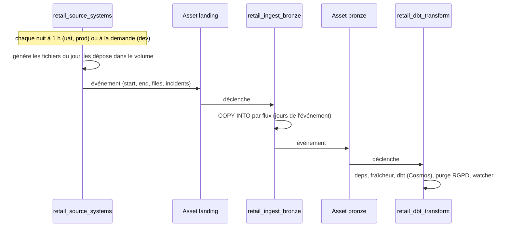

# 6. L'orchestration Airflow

Airflow 3.3 (Astro Runtime 3.3-9). Trois DAGs, chaînés par des **Assets** (ordonnancement piloté par les
données) : chaque DAG démarre quand la donnée dont il dépend a été mise à jour.



## 6.1 `retail_source_systems` : les systèmes sources

| | |
|---|---|
| Fichier | `dags/retail_source_systems.py` |
| Planning | `RETAIL_SOURCES_SCHEDULE` (défaut `0 1 * * *`, `none` = manuel) |
| `catchup` | `False` : à l'activation, seul le dernier intervalle est exécuté |
| Tâches | `ensure_landing_zone` (crée catalogue, schémas et volume s'ils n'existent pas) puis `land_source_files` : génère les fichiers dans un répertoire temporaire, les dépose dans le volume (SDK Databricks, 8 envois en parallèle, écrasement autorisé) |
| Sortie | Asset `dbx://retail/landing/raw`, avec en `extra` : `start`, `end`, nombre de fichiers, incidents |
| Reprises | 2, à 2 minutes d'intervalle |

**Paramètres** (formulaire *Trigger*) :

| Paramètre | Type | Effet |
|---|---|---|
| `start_date` | date ou vide | premier jour à déposer ; vide = le jour de l'intervalle planifié |
| `end_date` | date ou vide | dernier jour (défaut : `start_date`) |
| `incidents` | liste | incidents à injecter sur ces jours (liste déroulante) |
| `clean` | booléen | désactive les défauts intégrés |

Charger l'historique : *Trigger* avec `start_date = 2026-07-01`, `end_date = <hier>`.
Rejouer un jour proprement après un incident : *Trigger* avec ce jour, sans incident.

## 6.2 `retail_ingest_bronze` : la couche bronze

| | |
|---|---|
| Fichier | `dags/retail_ingest_bronze.py` |
| Planning | `schedule=[Asset landing]` |
| Tâches | `create_catalog_objects` (catalogue, schémas, volume) ; `plan_loads` (lit les jours dans les événements d'Asset et prépare le SQL) ; `copy_into` **mappée dynamiquement**, une instance par flux |
| Opérateur | `DatabricksSqlOperator` (provider Databricks), connexion `databricks_default` |
| Parallélisme | `max_active_tis_per_dagrun=3` : 3 flux à la fois, pour ménager le petit warehouse |
| Sortie | Asset `dbx://retail/bronze` |

Le *dynamic task mapping* : `DatabricksSqlOperator.partial(...).expand(sql=plan_loads())` crée autant de tâches
que de flux. `map_index_template` affiche le nom de la table dans l'interface au lieu d'un numéro.

Si le DAG est lancé à la main (sans événement d'Asset), `plan_loads` prend la veille et le jour courant.

## 6.3 `retail_dbt_transform` : silver et gold avec Cosmos

| | |
|---|---|
| Fichier | `dags/retail_dbt_transform.py` |
| Planning | `schedule=[Asset bronze]` |
| Target dbt | `DBT_TARGET` (variable du Deployment) |

```
dbt_deps ─► source_freshness ─► dbt (groupe Cosmos) ─► gdpr_purge_bronze
    └──────────────┴──────────────────┴──────────────────────┴──► watcher (one_failed)
```

| Tâche | Rôle |
|---|---|
| `dbt_deps` | installe `dbt_utils` dans le projet |
| `source_freshness` | `dbt source freshness` : **arrête tout** si un flux n'est plus à jour (erreur à 50 h) |
| `dbt` (groupe) | Cosmos : **une tâche par modèle, seed et snapshot**, avec ses tests juste après |
| `gdpr_purge_bronze` | `dbt run-operation purge_erased_customers` |
| `watcher` | `trigger_rule = one_failed` : échoue si une tâche a échoué, sinon `skipped` |

### La configuration de Cosmos, ligne par ligne

```python
DbtTaskGroup(
    project_config=ProjectConfig(DBT_PROJECT, install_dbt_deps=True),
    profile_config=ProfileConfig(profile_name="retail", target_name=DBT_TARGET,
                                 profiles_yml_filepath=DBT_PROJECT / "profiles.yml"),
    execution_config=ExecutionConfig(dbt_executable_path=DBT_EXECUTABLE,
                                     invocation_mode=InvocationMode.SUBPROCESS),
    render_config=RenderConfig(load_method=LoadMode.DBT_LS,
                               test_behavior=TestBehavior.AFTER_EACH,
                               should_detach_multiple_parents_tests=True,
                               dbt_executable_path=DBT_EXECUTABLE,
                               invocation_mode=InvocationMode.SUBPROCESS),
)
```

| Option | Pourquoi |
|---|---|
| `install_dbt_deps=True` | Cosmos copie le projet dans un répertoire temporaire pour chaque tâche : les packages y sont installés |
| `profiles_yml_filepath` | le `profiles.yml` du dépôt lit les variables d'environnement : même fichier en local et dans le cloud |
| `dbt_executable_path` | dbt est dans un **virtualenv séparé** (`/usr/local/airflow/dbt_venv`, créé par le Dockerfile) : dbt et Airflow ont des dépendances incompatibles |
| `InvocationMode.SUBPROCESS` | dbt n'est pas importable depuis Python d'Airflow : il faut l'appeler en sous-processus. Sans cette option (dans `ExecutionConfig` **et** `RenderConfig`), Cosmos 1.15 refuse de charger le DAG |
| `LoadMode.DBT_LS` | le graphe est calculé avec `dbt ls` au chargement du DAG (Cosmos le met en cache dans des Variables Airflow). En entreprise, on préfère `DBT_MANIFEST` avec un `manifest.json` produit par la CI |
| `TestBehavior.AFTER_EACH` | les tests d'un modèle tournent juste après lui : un test en échec **bloque tous les modèles en aval** |
| `should_detach_multiple_parents_tests` | un test qui touche plusieurs modèles (relation, test singulier) tourne après **tous** ses parents |

### Le watcher : pourquoi

Un DAG run est vert si ses **tâches feuilles** sont vertes. Une tâche de nettoyage en `all_done` placée en dernier
peut donc masquer un échec. Le `watcher` est une feuille en `one_failed` : si une tâche échoue, il échoue, et le
run est rouge. C'est le piège classique du DAG vert alors que des données ont été perdues.

## 6.4 La configuration commune

- **Connexion** `databricks_default` : variable d'environnement `AIRFLOW_CONN_DATABRICKS_DEFAULT` (JSON :
  `conn_type`, `host`, `password` = token, `extra.http_path`). En local, générée par
  `scripts/sync_airflow_connection.py` ; sur Astro, secret du Deployment.
- **Reprises** : `retries` sur toutes les tâches sauf le watcher (vérifié par les tests d'intégrité).
- **`max_active_runs=1`** sur chaque DAG : deux runs ne écrivent jamais les mêmes tables en même temps.

## 6.5 Les tests d'intégrité (`tests/dags/test_dag_integrity.py`)

| Test | Vérifie |
|---|---|
| `test_no_import_errors` | les trois DAGs se chargent sans erreur |
| `test_expected_dags` | les trois DAGs existent |
| `test_every_task_retries` | toute tâche (hors watcher) a au moins une reprise |
| `test_dbt_failures_fail_the_run` | le watcher est en `one_failed` et c'est une feuille |

`tests/conftest.py` désactive le cache Cosmos (`AIRFLOW__COSMOS__ENABLE_CACHE=False`) : le conteneur de test
n'a pas de base de métadonnées, et le cache utilise des Variables Airflow.

Lancer : `astro dev pytest tests` (dans l'image), ou la CI.
